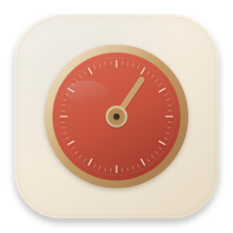

<h1 align="center">
  <a href="https://github.com/hbin/Pomodoro"></a><br>
  Pomodoro
</h1>

<p align="center">
  <strong>Free.</strong> A quiet focus timer for the macOS menu bar.<br>
  Choose focus or a break, then press Start. When an interval ends, the next
  step is ready; nothing starts without you.
</p>

<p align="center">
  <a href="#install"><strong>Install</strong></a> ·
  <a href="https://github.com/hbin/Pomodoro/releases/latest"><strong>Download</strong></a>
</p>

<p align="center">
  
  
  
  <a href="LICENSE"></a>
</p>

<p align="center">
  
  
</p>

## Install

Download the latest `Pomodoro.dmg` from
[Releases](https://github.com/hbin/Pomodoro/releases/latest), open it, and drag
**Pomodoro** into **Applications**.

If macOS blocks the first launch, open Pomodoro once, then go to
**System Settings → Privacy & Security** and choose **Open Anyway**.
Alternatively, clear the quarantine flag in Terminal:

```sh
xattr -dr com.apple.quarantine /Applications/Pomodoro.app
open /Applications/Pomodoro.app
```

## License

Pomodoro is free to use, modify, and distribute, including for commercial
purposes, under the [MIT License](LICENSE).
