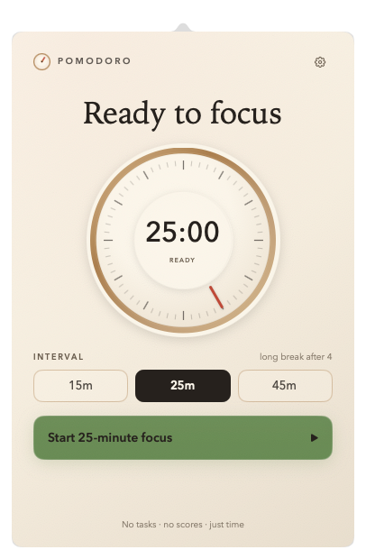
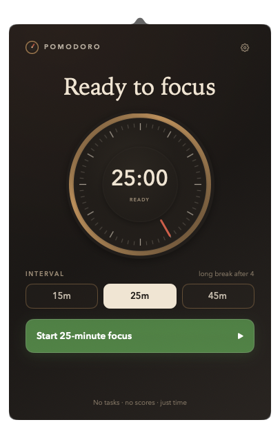

# Pomodoro

Pomodoro is a quiet focus timer that lives on the macOS menu bar. And it's free!
Enjoy the simple focus rhythm.

## Preview

| Light | Black |
| :---: | :---: |
|  |  |

## What it does

- Starts a 15, 25, or 45-minute focus interval.
- Offers a 5-minute break, or a 15-minute break after four focus intervals.
- Plays a soft chime when an interval finishes.
- Works entirely offline and stores no task or session history.

## Install

Download the latest `Pomodoro.dmg` from GitHub Releases, open it, and drag
**Pomodoro** into **Applications**.

Pomodoro requires macOS 15 or later.
