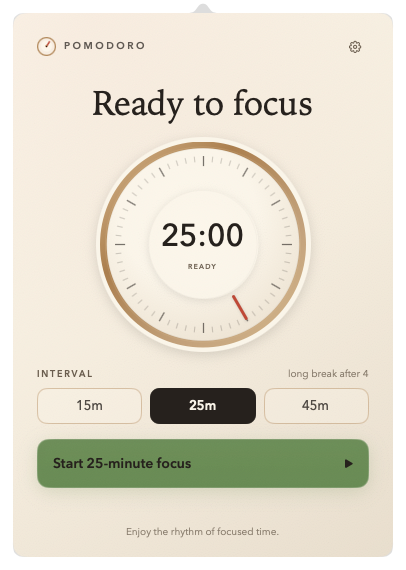
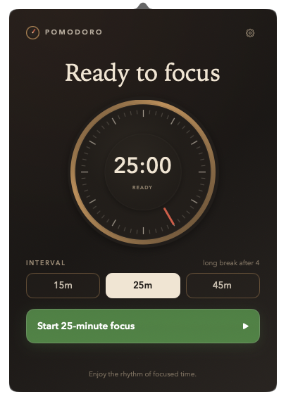

# Pomodoro

Pomodoro is a quiet focus timer that lives on the macOS menu bar. And it's free!
Enjoy the simple focus rhythm.

## Preview

 

## Install

Download the latest `Pomodoro.dmg` from the
[Releases](https://github.com/hbin/Pomodoro/releases/latest) page, open
it, and drag **Pomodoro** into **Applications**.

Pomodoro requires macOS 15 or later.
