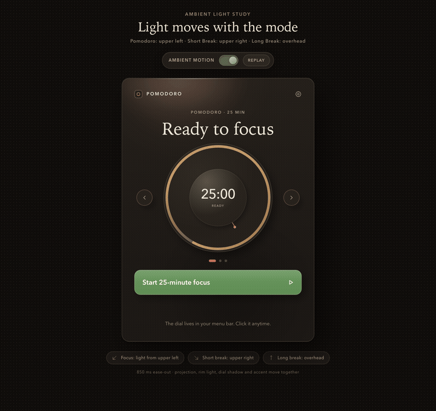
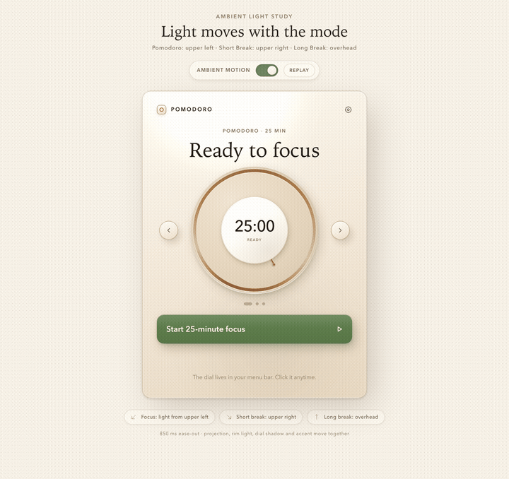

# Ambient Motion

- Status: Implemented in the native app for the idle interval tabs; this study remains the visual reference
- Date: 2026-11-23
- Scope: Idle timer mode switching for the fixed 25 / 5 / 15 interval direction

## Intent

Ambient motion makes the idle dial feel like a physical object under a fixed
light. It is not a decorative loop. Each mode has a light position, and changing
the mode moves the light, the cast shadow, and the accent together.

The effect must stay quiet enough to read as material behavior rather than a
spotlight animation.

## Mode light positions

| Mode | Light source | Cast shadow | Accent |
| --- | --- | --- | --- |
| Pomodoro | Upper left | Lower right | Tomato |
| Short Break | Overhead | Straight down, softer | Sage |
| Long Break | Upper right | Lower left | Deep sage accent; brass ambient light and thin channel edges |

The three position dots below the dial are ordered Pomodoro, Short Break, Long
Break. The light direction follows that order: left, overhead, right.

The native idle surface applies the same rule to its three mode dots:
Focus 25 upper left, Short break 5 overhead, Long break 15 upper right.

## Black theme

<p align="center">
  
</p>

## Light theme

<p align="center">
  
</p>

## Motion anatomy

- Duration: 850 ms.
- Easing: `cubic-bezier(0.2, 0.78, 0.18, 1)`.
- The card projection moves opposite the light.
- The card's paper angle, top rim, glows, dial face, plaque, and cast shadow
  share one light direction per mode. No lit surface may keep a fixed
  directional highlight; the thin brass channel edges are fixed material trim,
  not a second light source.
- The top rim light travels with the light source.
- The dial face and center plaque highlights move with the light; their shadows
  shift by a smaller amount.
- The colored ambient glow crossfades from the outgoing mode to the incoming
  mode.
- Mode copy, duration, pointer, position dots, and the primary button change in
  the same transition.
- Mode switching is available only while idle. No ambient motion runs during an
  active or paused interval.

The pointer rotates independently over 700 ms. On the idle surface it points at
the selected duration's minute position on the 60-minute dial: 25 minutes at
five o'clock, 5 at one o'clock, 15 at three o'clock. The primary takes the
selected mode's fill; Start and Pause keep that fill, so starting an
interval needs no button-color transition.

## Theme treatment

### Black

- Use a true black cast shadow and reserve light for the rim and accent glows.
- Keep the accent glows saturated enough to read against the dark ground.
- Move the light about 74 points horizontally. The larger range is safe because
  the card is already dark and the highlight supplies the contrast.
- The dial face and plaque use the same `30%` / `50%` / `70%` positions as the
  Light theme, with the thin brass channel edges supplying the black theme's edge
  material.
- The external cast shadow is not the primary direction signal on black: it
  measures only 2.4–2.9 luma units against the near-black ground. Direction is
  carried by the top rim, the moving dial face and plaque highlight, and the
  moving inner shade. Do not raise the external shadow to compensate.

### Light

- Use a warm brown cast shadow rather than black.
- Use near-white, slightly tinted glows with additive blending so transitions do
  not muddy the paper.
- Rotate the card's paper gradient with the mode: `163deg` for Pomodoro,
  `180deg` for Short Break, and `197deg` for Long Break. The centered `0.28`
  top wash is symmetric and stays in every mode. In the native app the same
  angles apply to the Focus / Short break / Long break mode dots.
- Move the dial face and plaque highlight to `30%` / `50%` / `70%`
  horizontally, with dial y `24%` / `14%` / `24%` and plaque y `22%` / `12%` /
  `22%`. The plaque carries a soft opposing shade so its raised face reads as
  lit from the named side.
- Reduce horizontal travel to about 56 points and keep the shadow close to the
  card.
- Preserve the enamel plaque, thin brass channel edges, and letterpress title
  treatment from the refined Light palette.

## Native implementation

- `AmbientPose` maps the three `IdleMode` dots (Focus 25, Short break 5,
  Long break 15) to the left / overhead / right pose.
- Light rotates the card paper between `163deg` and `197deg`; Black keeps the
  paper vertical and carries direction with the top rim, dial face, plaque,
  and shade.
- The light follows the selected mode dot. Starting a break does not animate
  it.
- The pointer uses the selected duration on the 60-minute dial and rotates
  over 700 ms.
- The timer card uses 510 points (340 wide); Settings shares the 340-point
  width and keeps its independent measured height.
- All three mode dots use the mode accent at full opacity; only the active dot
  is wider. A single current-mode label below the dots uses the mode accent;
  the 32-point arrows expose hover help, announce the current mode, and use a
  44-point hit area.
- The native primary uses the active mode fill in every state: Focus brick,
  Short break leaf, Long break deep sage. It has a centered label, a trailing
  play/pause glyph, and a label color tuned per fill. Start, Pause, and the
  completion Start share the mode fill; the button uses a clean highlight and a
  subtle black shadow without a colored glow.
- The ambient light is limited to the clock page; Settings uses the plain card
  background.
- The status line uses the mode row, so the dial and primary do not move between
  idle and running.
- The idle pointer keeps the tomato color; only the running phase accent
  changes it.
- Duration: 850 ms, `cubic-bezier(0.2, 0.78, 0.18, 1)`. Reduce Motion updates
  the pose without movement. Reduce Transparency omits the translucent rim,
  glow, and shade while keeping the opaque dial and paper.

The native app was inspected at Focus 25, Short break 5, and Long break 15 in
Light and Black. The committed `docs/assets/readme/light-theme.png` and
`docs/assets/readme/black-theme.png` show the Focus 25 upper-left pose.

## Verification

The measurements below cover the standalone study. Run this from the
visualization directory that contains the two preview HTML files. Capture settled stills at 2× with a 2500 ms virtual-time budget so the
850 ms transition is complete:

```sh
CH="/Applications/Google Chrome.app/Contents/MacOS/Google Chrome"
for theme in dark light; do
  case $theme in dark) page=pomodoro-ambient-motion-preview.html;; light) page=pomodoro-light-ambient-motion-preview.html;; esac
  for mode in pomodoro short long; do
    "$CH" --headless=new --disable-gpu --hide-scrollbars --force-device-scale-factor=2 \
      --window-size=860,810 --virtual-time-budget=2500 \
      --user-data-dir="/tmp/chrome-ambient-$theme-$mode" \
      --screenshot="/tmp/ambient-$theme-$mode.png" "file://$PWD/$page#$mode" >/dev/null 2>&1
  done
done
```

Measure luma with `ffmpeg`:

```sh
m(){ ffmpeg -v info -i "$1" -vf "crop=$2:$3:$4:$5,signalstats,metadata=print" \
  -frames:v 1 -f null - 2>&1 | sed -n 's/.*YAVG=//p' | head -1; }
```

Regions in the 1720×1620 stills (`w:h:x:y`):

| id | crop | area |
| --- | --- | --- |
| topL | `140:22:500:305` | inside card top band, left |
| topR | `140:22:1080:305` | inside card top band, right |
| midL | `70:180:490:430` | left paper margin |
| midR | `70:180:1160:430` | right paper margin |
| pL | `30:15:795:725` | plaque upper-left, above the time glyphs |
| pR | `30:15:895:725` | plaque upper-right, above the time glyphs |
| shadowL | `40:260:440:700` | outside card, shadow side left |
| shadowR | `40:260:1240:700` | outside card, shadow side right |

The plaque crops must stay above the time glyphs (which begin around y=745 in
the still); a lower crop measures glyph shapes rather than light.

Required results:

| Theme | Mode | Top band | Mid band | Plaque | Cast shadow |
| --- | --- | --- | --- | --- | --- |
| Light | Pomodoro | `topL - topR >= 6` | `midL - midR >= 4` | `pL - pR >= 2` | `shadowL - shadowR >= 6` |
| Light | Short | `abs(topL - topR) <= 3` | `abs(midL - midR) <= 3` | `abs(pL - pR) <= 2` | `abs(shadowL - shadowR) <= 3` |
| Light | Long | `topR - topL >= 6` | `midR - midL >= 4` | `pR - pL >= 2` | `shadowR - shadowL >= 6` |
| Black | Pomodoro | `topL - topR >= 10` | not gated | `pL - pR >= 2` | not gated |
| Black | Short | `abs(topL - topR) <= 3` | not gated | `abs(pL - pR) <= 2` | not gated |
| Black | Long | `topR - topL >= 10` | not gated | `pR - pL >= 2` | not gated |

Black's external shadow is deliberately not gated: it measures only 2.4–2.9
and cannot read on black. Direction is carried by the top rim and plaque.

For the 720×678 GIFs, hold frames 7 / 49 / 96 use `topL 59:9:209:128`,
`topR 59:9:452:128`, `pL 13:6:333:304`, and `pR 13:6:375:304`; require at least
3 luma for the top band and 1 for the plaque, with the signs above.

## Accessibility

- When Reduce Motion is enabled, update the native light pose without movement;
  the selected interval changes immediately. The standalone study crossfades
  the mode content and colors instead.
- The motion is supplementary. Every mode remains identifiable through its
  title, duration, mode label, pointer, and primary action copy.
- A design-review toggle compared ambient motion on and off.
- Motion stops when the timer is not idle.

## Implementation constraints

- Do not animate the `NSPopover` system window shadow. It is owned by AppKit and
  is not a stable design surface.
- Animate an in-content blurred rounded shape behind the card instead. Drive it
  with translation and opacity so the compositor can keep the transition smooth.
- Do not recalculate blur radius or shadow spread every frame.
- Keep the ambient layers behind the popover content and above its background.
- Use `Palette` and `Typo`; do not add one-off colors or fonts.
- Verify Light, Black, and Reduce Motion before considering the effect complete.

## Open questions

- Confirmed 2026-11-23: fixed 25 / 5 / 15 arrow-mode direction; implementation
  pending.
- The native ambient light is always on in 0.4.0; decide whether to expose a
  setting.
- Confirm whether the design study's Long Break keeps the faint brass warmth or
  uses sage only.
