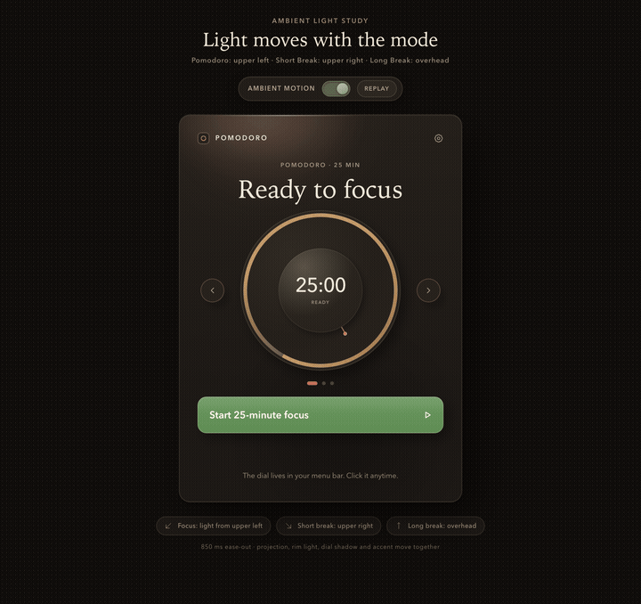
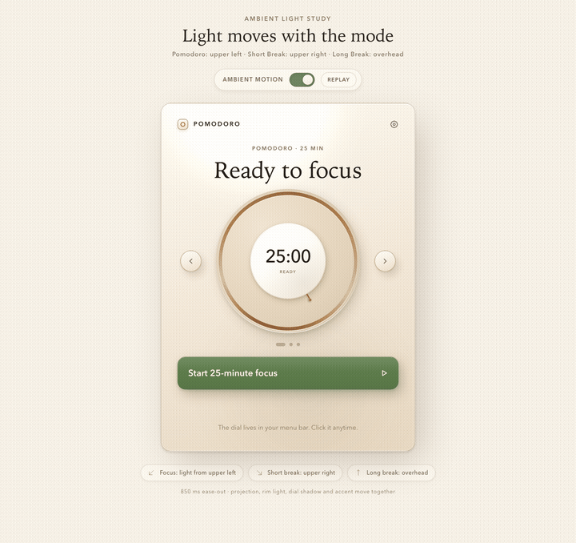

# Pomodoro Direct Break

**Product specification**

| Field | Value |
| --- | --- |
| Status | Draft for approval |
| Target release | 0.4.0 |
| Feature branch | `codex/direct-break-v0.4` |
| Product stance | Pomodoro remains a one-off timer |
| Date | 2026-11-23 |
| Platform | macOS 15+ |
| Parent roadmap | `2026-11-23-interaction-milestones-design.md` (main repository) |
| Visual study | [Ambient motion](../../design/ambient-motion.md) |

## Contents

1. [Summary](#1-summary)
2. [Competitive basis](#2-competitive-basis)
3. [Goals](#3-goals)
4. [Non-goals](#4-non-goals)
5. [Idle experience](#5-idle-experience)
6. [Timer engine](#6-timer-engine)
7. [Persistence](#7-persistence)
8. [Menu bar, notifications, and sound](#8-menu-bar-notifications-and-sound)
9. [Localization](#9-localization)
10. [Accessibility](#10-accessibility)
11. [Visual and layout direction](#11-visual-and-layout-direction)
12. [Risks and mitigations](#12-risks-and-mitigations)
13. [Edge cases](#13-edge-cases)
14. [Acceptance criteria](#14-acceptance-criteria)
15. [Dependencies and sequencing](#15-dependencies-and-sequencing)
16. [Implementation decisions](#16-implementation-decisions)
17. [Follow-ups](#17-follow-ups)
18. [References](#18-references)

## 1. Summary

Pomodoro currently offers a break only after a focus interval reaches its
natural completion. This feature lets a person start a five-minute short break
or fifteen-minute long break directly from the idle screen.

The addition is intentionally small. A break is a timer state, not a workflow.
Starting one manually does not advance or reset focus rhythm. The existing
phase glyph, notification, pause/resume, sleep/wake, and restoration behavior
apply unchanged.

This branch has no dependency on the deferred Focus Note concept and does not
introduce session context or task behavior. The idle visual direction is
documented in the [ambient motion study](../../design/ambient-motion.md) and
summarized in [§11.2](#112-ambient-motion-study); it is a design reference for
the idle surface, not a second workflow.

## 2. Competitive basis

PomoFocus makes Pomodoro, Short Break, and Long Break available from one timer
surface. That directness is useful, but its ability to switch phases during an
active interval would discard timer context without enough protection.

Pomodoro adapts the idea conservatively: direct break access is available only
while idle. Mid-interval switching remains excluded.

## 3. Goals

1. Let a person start a short or long break without first completing a focus.
2. Keep both actions secondary to the primary Start focus action.
3. Preserve focus count, long-break cadence, and all existing rhythm rules.
4. Reuse the existing break timer, menu-bar icon, notifications, sounds, and
   restoration behavior.
5. Keep the control unavailable whenever changing phase could discard an
   active interval.

### Success criteria

- A short-break action starts an accurate five-minute interval.
- A long-break action starts an accurate fifteen-minute interval.
- Manual breaks do not change the completed focus count.
- The fourth naturally completed focus still recommends a long break.
- The break action is available only in idle.
- A running or paused break supports the existing pause, resume, end-early,
  notification, sleep/wake, and relaunch behavior.
- The idle screen remains usable in all four supported languages.
- The idle visual direction follows the light-position rule in
  [§11.2](#112-ambient-motion-study) in both themes.

## 4. Non-goals

- Switching phases while a focus or break is running or paused.
- Pausing a focus and switching directly to a break.
- Auto-starting a break after focus completion.
- Changing the five- or fifteen-minute durations.
- Configurable break durations or long-break cadence.
- Tasks, projects, estimates, or history.
- Focus notes or any other session context.
- Keyboard shortcuts.
- A global hotkey.
- A floating timer window.
- Accounts, sync, reports, rankings, ads, or premium features.

### Anti-goals

The feature fails if it:

- makes a manual break look like a primary workflow;
- makes an early-ended focus count toward rhythm;
- changes the fourth-focus long-break recommendation;
- allows an accidental destructive phase switch; or
- makes the idle screen feel like a control panel.

## 5. Idle experience

The existing title, dial, duration choices, primary Start button, and footer
remain in place.

A pair of equal-width secondary buttons appears below the primary control. They
use the existing outlined plaque treatment and are labelled:

- **Short break · 5 min**
- **Long break · 15 min**

The pair is secondary to Start but visually distinct enough to scan as real
actions. Selecting either one starts that break immediately. The ambient motion
study in [§11.2](#112-ambient-motion-study) shows this idle surface in both
themes.

### 5.1 Visibility

- The break actions are visible only when the timer is idle.
- They are hidden during focus running, focus paused, focus completed, break
  running, break paused, and break completed.
- The focus-completion screen continues to offer its recommended break exactly
  as it does today.
- Rapid repeated selection cannot start more than one interval or schedule more
  than one notification.

### 5.2 Starting a manual break

Starting a direct break:

- sets the phase to `shortBreak` or `longBreak`;
- uses the existing five- or fifteen-minute duration;
- sets an absolute end date;
- enters the running state;
- updates the menu-bar break icon and remaining minutes;
- schedules one completion notification; and
- persists the active break through the existing state model.

It does not:

- change `completedFocusCount`;
- reset or advance the long-break cadence;
- mark a focus as complete;
- count the break in any history.

### 5.3 While the break runs

- The existing break dial, colors, copy, and menu-bar cup icon remain.
- Pause freezes the remaining break time and cancels the pending notification.
- Resume creates a new end date and reschedules the notification.
- End early returns to idle.
- Sleep, screen lock, quit, and relaunch use the existing reconciliation path.
- Completion uses the existing break-complete state.
- A completed manual break offers **Start another focus** and **Done for now**
  exactly like a completion-triggered break.

### 5.4 State matrix

| State | Break actions | Manual break allowed |
| --- | --- | --- |
| Idle | Available | Yes |
| Focus running | Hidden | No |
| Focus paused | Hidden | No |
| Focus completed | Hidden | No; use the recommended-break action |
| Break running | Hidden | No |
| Break paused | Hidden | No |
| Break completed | Hidden | No |

## 6. Timer engine

- Add one engine operation that starts a specified break while idle.
- The operation must reject focus phases and any non-idle run state.
- It must use the existing short- and long-break durations.
- It must preserve `completedFocusCount`.
- Completion, pause, resume, restore, and early-end behavior reuse existing
  break logic.

Deterministic tests must use `TestClock`; no wall-clock sleeps.

## 7. Persistence

- No new persisted field is required.
- The existing `phase`, `runState`, `totalSeconds`, `remainingSeconds`, and
  `endDate` fields store a direct break.
- Existing state files remain readable.
- Active and paused manual breaks restore exactly like recommended breaks.
- No session-context or task field is added.

## 8. Menu bar, notifications, and sound

- The menu bar shows the same cup and remaining-time treatment used by existing
  breaks.
- Manual and recommended breaks schedule the same notification content.
- The completion chime and notification rules remain unchanged.
- Tick sound does not play during breaks.
- Notifications never contain user-entered context.

## 9. Localization

All new copy belongs in `Resources/Localization/Localizable.xcstrings` with
English, Simplified Chinese, Traditional Chinese, and Japanese values. Resolve
it through `L10n`.

Required semantic keys and English source values:

| Key | English source |
| --- | --- |
| `timer.break.short_with_minutes` | **Short break · %lld min** |
| `timer.break.long_with_minutes` | **Long break · %lld min** |

Use whole localized sentences with numeric placeholders rather than
concatenating a localized label and duration.

## 10. Accessibility

- Each break control's accessible name includes its duration.
- Keyboard focus reaches the short-break action after Start, then the
  long-break action, before the footer.
- Both actions are reachable with the keyboard and VoiceOver.
- Starting a break posts the existing localized break-start announcement.
- The controls' purpose and state do not depend on color alone.

## 11. Visual and layout direction

### 11.1 Idle layout

- Use only `Palette`, `Typo`, and existing shared components.
- The controls are a pair of equal-width outlined buttons, not additional
  filled primary actions.
- Do not reduce the 215-point dial.
- Preserve the 380-point popover width.
- Starting from the current layout, add only the vertical space needed for the
  break actions; target roughly 580 points total.
- Keep Settings at its current height and layout.
- Verify Light, Black, System appearance, and Reduce Transparency.
- Do not animate break start. The ambient motion study below covers idle mode
  switching only.

### 11.2 Ambient motion study

The idle surface uses the ambient motion study as its visual reference. The
study is idle-only: it does not add a runtime control, a workflow, or a
break-start animation.

**Black theme**

  

<em>Pomodoro → Short Break → Long Break → Pomodoro. The top rim, dial face, plaque, and inner shade move together.</em>

**Light theme**

  

<em>Pomodoro → Short Break → Long Break → Pomodoro. The paper angle, dial face, plaque, and cast shadow share one light direction.</em>

**Light-position rule**

| Mode | Light paper angle | Dial highlight | Plaque highlight | Cast shadow |
| --- | --- | --- | --- | --- |
| Pomodoro (first dot) | 163° (upper left) | 30% / 24% | 30% / 22% | Lower right |
| Short break (second dot) | 180° (overhead) | 50% / 14% | 50% / 12% | Straight down |
| Long break (third dot) | 197° (upper right) | 70% / 24% | 70% / 22% | Lower left |

The three position dots are ordered Pomodoro, Short break, Long break. The light
direction follows the same left → overhead → right order as the dots.

The dial and plaque positions apply to both themes. The paper-angle column is
Light-only: Black keeps its dark paper at 180° and carries direction with the
top rim, dial face, plaque, and inner shade; its external cast shadow is not a
primary signal. In Light, the paper gradient rotates with the mode and the
centered top wash stays symmetric. No paper, dial, plaque, or shadow surface
keeps a fixed directional highlight; the brass bezel's conic is a fixed
material treatment, not a second light source.

The visual direction passed the measured still and GIF hold-frame gates on
2026-11-23. The repeatable capture regions, thresholds, and results are in the
[ambient motion verification](../../design/ambient-motion.md#verification).

| Theme | Pomodoro | Short break | Long break |
| --- | --- | --- | --- |
| Light | Top left; plaque left; shadow right | Symmetric | Top right; plaque right; shadow left |
| Black | Top left; plaque left | Symmetric | Top right; plaque right |

## 12. Risks and mitigations

| Risk | Mitigation |
| --- | --- |
| An active interval is replaced by an accidental phase switch | Break actions are hidden unless idle; the engine rejects focus phases and non-idle run states. |
| A manual break advances or resets rhythm | Direct start preserves `completedFocusCount`; deterministic tests cover the unchanged fourth-focus cadence. |
| Rapid selection starts two intervals or schedules two notifications | The idle-only engine guard permits one start; tests cover repeated selection and one notification. |
| Relaunch completes an expired break more than once | Existing reconciliation completes at most once; relaunch tests cover before and after the end date. |
| Localized copy overflows the idle layout | Four-language copy uses whole sentences with placeholders; inspect all four languages before completion. |
| The secondary pair dilutes the primary Start action | Use outlined equal-width buttons, keep Start filled, and hold the roughly 580-point total height. |
| The idle surface reads as lit from the wrong side | Apply the shared light-position rule in [§11.2](#112-ambient-motion-study); the measured still and GIF gates must pass. |
| The ambient study is mistaken for a required 0.4.0 setting | Treat it as an idle visual reference; the default/setting decision remains a follow-up in [§17](#17-follow-ups). |

## 13. Edge cases

- A direct break can be started immediately after ending a focus early, because
  ending early returns the app to idle.
- A manual long break does not reset a partially completed four-focus cadence.
- A manual break cannot begin while any other interval is active or paused.
- Closing the popover leaves the break running.
- Relaunching during a manual break restores it without creating a completion
  before the end date.
- Relaunching after a manual break expired completes it exactly once.
- Notification denial does not block the break.
- Language changes reschedule the pending break notification at the same end
  date.
- A corrupt state file follows the existing backup and reset behavior.

## 14. Acceptance criteria

- Short-break and long-break actions appear only on idle.
- The actions use the existing five- and fifteen-minute durations.
- A short-break action starts an accurate 5:00 interval.
- A long-break action starts an accurate 15:00 interval.
- Neither action changes `completedFocusCount` or the long-break cadence.
- The fourth natural focus completion still recommends a long break.
- The break actions are absent during running, paused, and completed states.
- A manual break supports pause, resume, end early, notifications, sleep/wake,
  and relaunch.
- The menu-bar break icon and minutes are correct.
- The idle and break screens fit in all four languages.
- Light, Black, System, and reduced-transparency states remain legible.
- No keyboard shortcut, task behavior, or history is added.
- `TESTING.md` gains coverage for direct short breaks, direct long breaks,
  rhythm neutrality, restoration, and phase-action visibility.
- Because the home popover changes, `README.md` and its screenshots are updated.
- The feature spec includes both ambient-motion GIFs and the light-position
  rule; the measured direction gates pass.
- `swift test` passes.
- New deterministic `TestClock` tests cover direct break start, pause/resume,
  completion, early end, restoration, and unchanged focus counting.
- `swift scripts/check-localizations.swift .` passes.
- `./scripts/build-app.sh debug` passes.
- The built app is inspected in the affected states and appearances.

## 15. Dependencies and sequencing

- Target version 0.4.0.
- Start and finish this branch directly from `main`; no rebase onto Focus Note
  is required.
- Focus Note and Add Task are deferred until the product moves beyond a
  one-off timer.
- The local Space shortcut and custom rhythm controls remain later follow-ups.

## 16. Implementation decisions

- Keep direct breaks available only from idle.
- Do not copy PomoFocus's always-available phase tabs.
- Reuse existing break durations, notifications, menu-bar state, and sound
  rules.
- Keep manual breaks rhythm-neutral.
- Do not add a persisted field or task behavior.
- Use `L10n` and shared design tokens for every new string and view.
- Do not add keyboard shortcuts in this branch.
- Keep ambient motion idle-only; do not animate break start.
- Regenerate both theme GIFs from the same light-position rule when the visual
  study changes.

## 17. Follow-ups

These affect the idle visual study, not the direct-break behavior:

- Decide whether ambient motion is on by default or exposed as a setting.
- Confirm whether Long Break keeps the faint brass warmth or uses sage only.

## 18. References

- [Pomodoro product design](2026-11-21-pomodoro-product-design.md)
- Parent roadmap: `2026-11-23-interaction-milestones-design.md` (main
  repository)
- [Ambient motion study](../../design/ambient-motion.md)
- Generated assets: [`ambient-motion-black.gif`](../../design/ambient-motion-black.gif),
  [`ambient-motion-light.gif`](../../design/ambient-motion-light.gif)
