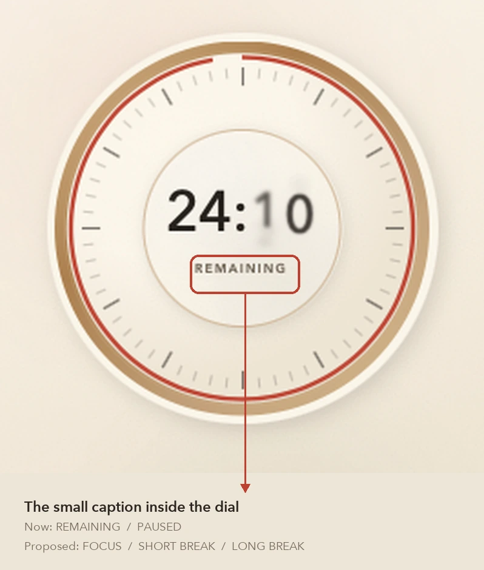
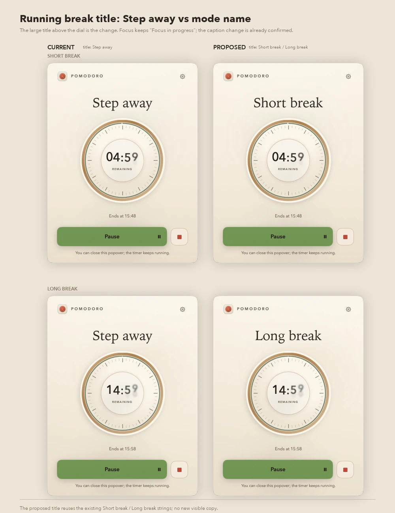
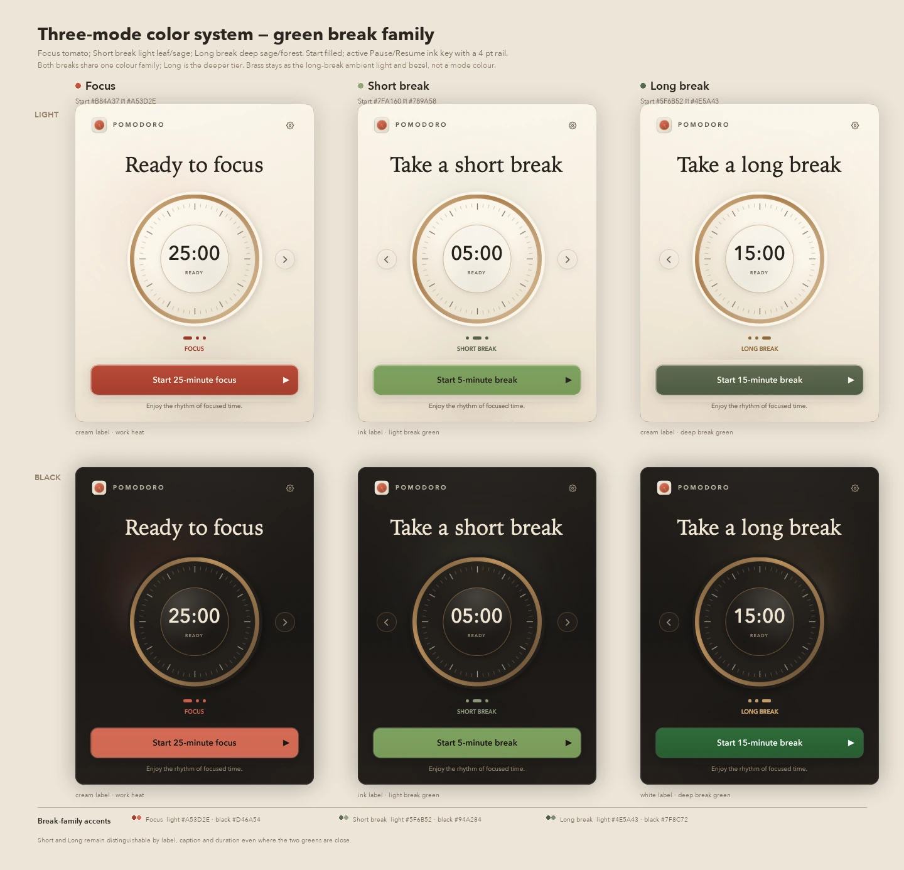
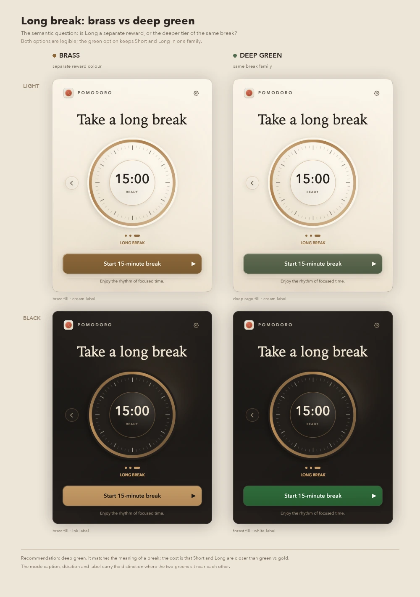
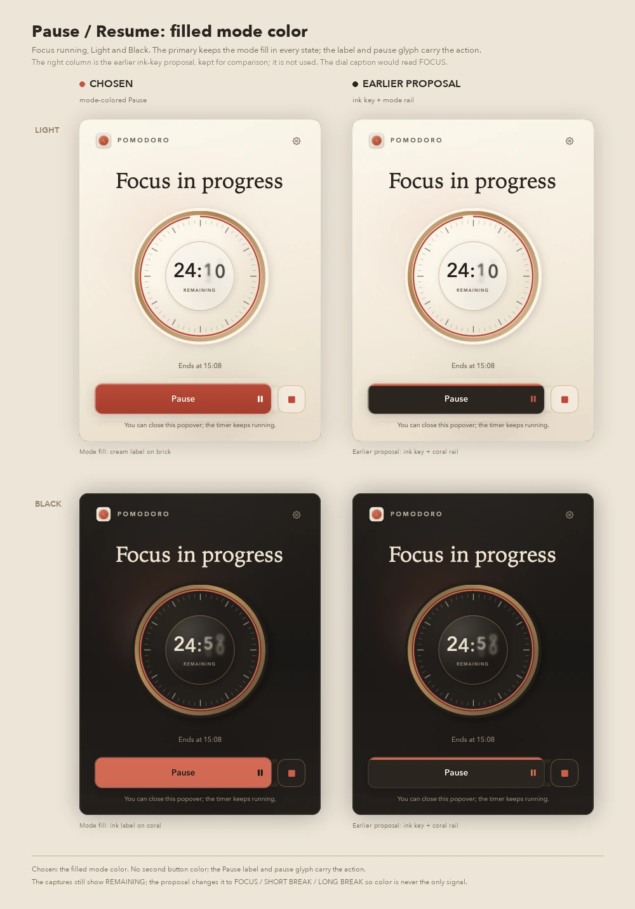
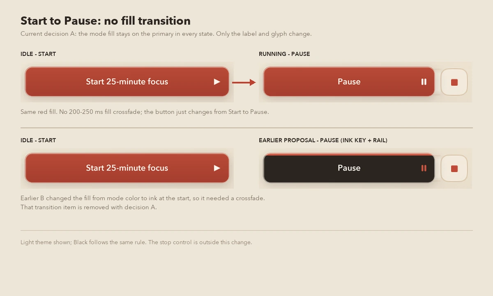
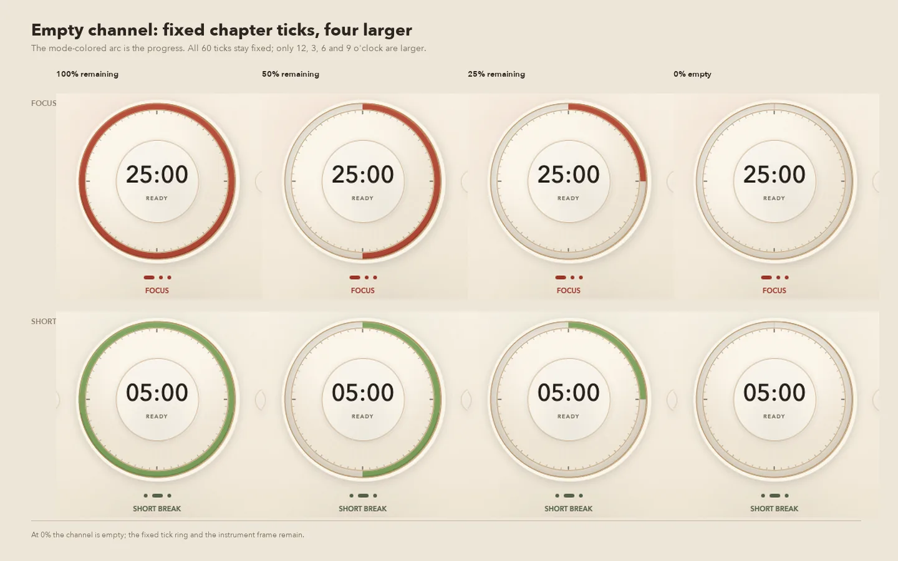
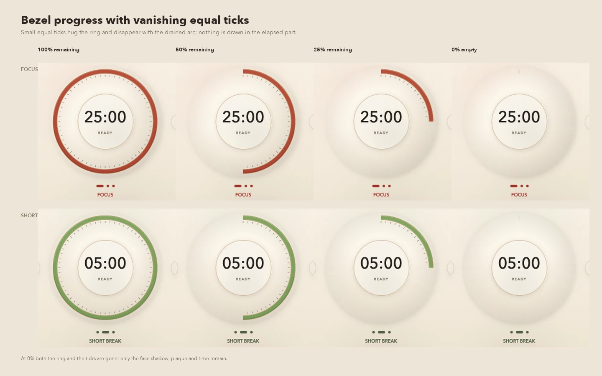
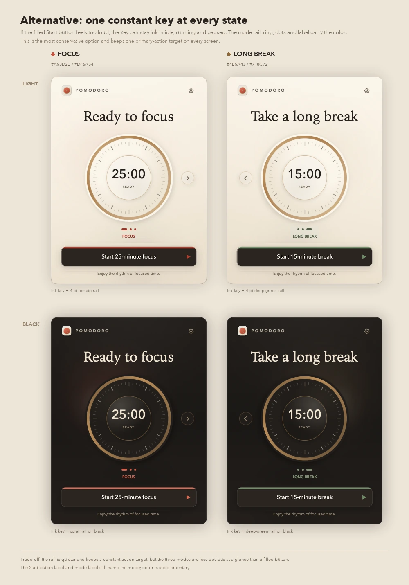

# Three-Mode Color System

**Design specification — implemented**

| Field | Value |
| --- | --- |
| Status | Implemented and locally verified; not committed or released. |
| Date | 2026-11-24 |
| Platform | macOS 15+ |
| Decision owner | Product owner |
| Amends | `2026-11-21-pomodoro-product-design.md` §9.2 and §9.4 |
| Related | `docs/design/ambient-motion.md`, `2026-11-24-session-dial-design.md`, `2026-11-24-pause-end-control-design.md` |
| Execution | [`2026-11-24-mode-color-system-todo.md`](2026-11-24-mode-color-system-todo.md) |

> **Implementation status.** This direction is implemented in the working
> tree: `ModeColors`, the mode-filled primary, the empty-channel dial, the fixed
> 60-tick ring, the mode captions/title, and the short/long accessibility keys.
> The comparison images remain composites from current Light and Black captures
> rather than release screenshots. `README.md` screenshots are stale until the
> next release. Nothing has been committed, tagged, or released.
>
> **Revision 2026-11-24.** The first study put Long break in brass. Product
> review agreed that Short and Long are both breaks and should stay in one
> green family, with Long as the deeper tier. The revised proposal uses deep
> green for the Long mode accent and Start button; brass stays as the ambient
> light and instrument trim unless the fully green ambient variant is chosen.
> The primary keeps the mode fill in every state, including Pause and the
> paused Start state;
> the earlier ink-key + rail treatment is not used. The brass study is kept in
> §6 for comparison.
>
> **Follow-up 2026-11-24.** The primary's visible copy is simplified to two
> labels: `Start` while idle, paused, or offering the next interval, and
> `Pause` while running. The mode-fill treatment is unchanged; the existing
> captures still show the earlier `Resume` copy.
>
> **Revision 2026-11-24 (bezel).** The bezel is confirmed as an empty
> recessed channel with thin brass edges. The thick brass fill track and the
> separate thin progress ring are removed. The remaining session is a
> mode-colored arc in the channel. The 60 ticks stay fixed around the face; only
> the 12, 3, 6 and 9 o'clock marks are larger. They do not vanish with the arc:
> at 0% the channel is empty, but the tick ring and the instrument frame remain.
> The flush-face/vanishing-tick variant is kept as a study, not chosen.
>
> **Revision 2026-11-24 (end control).** The running end control is a quiet
> `forward.end.fill` glyph shown only while the interval runs. It uses
> `Palette.mutedInk` with a hover/focus plaque disc, and takes no tomato or mode
> fill in any state. The end action is immediate for Focus and Break, with no
> confirmation step. Earlier statements in this spec that call the stop control
> out of scope, unchanged, or scheduled separately are historical; see
> `2026-11-24-pause-end-control-design.md` for the current design.

## 1. Decision summary

| Question | Recommendation | Alternatives | Status |
| --- | --- | --- | --- |
| Long-break family | Green, a deeper tier of the Short break green | Brass; a deep pine/teal | **Confirmed** |
| Long-break palette | Light deep sage `#5F6B52 → #4E5A43`; Black forest `#2F6B3A → #285D32` | Brass; marginally darker forest | **Confirmed** |
| Short-break palette | Light leaf `#7FA160 → #789A58`; Black leaf `#7FA160 → #789A58` on the dark card | Deep leaf in Black; pale sage | **Confirmed** |
| Black Short button | Light leaf fill with ink text, leaving the deep forest tier for Long | Keep deep forest; make Long only marginally darker | **Confirmed** |
| Primary-button treatment | Filled mode color in **every state**: Start, Pause and completion | Ink key + rail (earlier proposal); constant key | **Confirmed** |
| Focus color | Light brick `#B84A37 → #A53D2E`; Black coral `#D46A54 → #CE6853` | Deep tomato in both themes | **Confirmed** |
| Long-break ambient | Keep the existing brass light as a material accent, not a mode color | Switch the ambient to the deep-green accent | **Confirmed** |
| Running/paused mode text | Replace `REMAINING` / `PAUSED` in the dial caption with `FOCUS` / `SHORT BREAK` / `LONG BREAK` | Add new title keys; add an eyebrow label | **Confirmed** |
| Dial accessibility labels | Add `Short break timer` / `Long break timer` for VoiceOver; no visible UI or layout change | Keep the generic `Break timer` | **Confirmed** |
| Dial bezel | Empty recessed channel with thin brass edges; mode-colored remaining arc; fixed 60-tick ring with only 12/3/6/9 larger | Flush arc with vanishing ticks (no frame); keep brass + thin ring | **Confirmed** |
| Running title | Name the break: `Short break` / `Long break` instead of `Step away`, reusing `timer.mode.*` | Keep `Step away`; rely on the caption | **Confirmed** |

The implemented result is:

- Focus reads as tomato; both breaks read as green, with Short as the fresh,
  lighter tier and Long as the deep, quieter tier. The mode family is
  semantically coherent.
- The primary uses the mode fill in every state, including Pause and the
  paused Start state;
  only the label and play/pause glyph change. This removes the second ink-key
  style and keeps one button color per mode.
- The dial bezel becomes an empty recessed channel with thin brass edges. The
  remaining session is a mode-colored arc; the 60 ticks stay fixed, with only
  12, 3, 6 and 9 o'clock larger. At 0% the channel is empty, but the tick ring
  and thin frame remain, so the dial does not go bare.
- The long break is distinguished from short break by a value step in the
  button, ring, dots and label, plus explicit mode text. It no longer depends
  on a third hue.
- Brass remains the ambient light and the thin bezel edges/trim. It is not a
  mode signal.
- The menu-bar icon, timer behavior, persistence, notifications and Settings
  are untouched.

## 2. Current state

The popover currently has two accent families and one constant action color.

| Surface | Focus | Short break | Long break |
| --- | --- | --- | --- |
| Idle title | Ready to focus | Take a short break | Take a long break |
| Running title | Focus in progress | Step away | Step away |
| Dial ring | Tomato | Sage | **Sage** |
| Mode dots and label | Deep tomato | Deep sage | **Deep sage** |
| Ambient light | Upper left, tomato | Overhead, sage | Upper right, brass |
| Primary button | Leaf | Leaf | Leaf |
| End control glyph | Muted ink | Muted ink | Muted ink |
| Dial caption while running | `REMAINING` | `REMAINING` | `REMAINING` |

The end control row records the current muted-ink treatment: a quiet
`forward.end.fill` shown only while running, with no plate at rest and no tomato
or mode fill. Its geometry and styling are specified in
`2026-11-24-pause-end-control-design.md`; the earlier red stop square is no
longer the design.

Short and long breaks differ mainly by duration, the ambient-light position
and a faint brass warmth. While running, the title is the same `Step away`,
the ring is the same sage, and the mode label is hidden. The primary button is
always leaf green, so it does not help identify the mode.

The first proposal solved this by giving Long break a brass mode color. Review
rejected that direction: brass made Long feel like a separate reward or a
different category, even though both Short and Long are breaks. The revised
proposal keeps one green family and creates the third identity through depth,
text and position instead of a third hue.

## 3. Goals and non-goals

### Goals

- Make Focus, Short break and Long break recognizable at a glance in idle,
  running, paused and completion states.
- Keep Short and Long in one green break family, with Long as the deeper tier.
- Use the primary button as the strongest mode signal without turning the
  running screen into a red/green/gold control panel.
- Keep the existing warm instrument palette: tomato, leaf/sage, brass, ink and
  paper. Brass remains the material/light accent, not a mode color.
- Pass WCAG contrast for the label, the mode text and the non-text ring.
- Keep every mode readable without color: titles, durations, mode labels,
  button copy and dot width remain.
- Keep the popover dimensions, the Settings card and all timer behavior
  unchanged.
- Work in Light and Black, with Reduce Motion and Reduce Transparency, in all
  four languages.

### Non-goals

- Changing the menu-bar icon, its glyph or its monochrome template behavior.
- A new illustration, mascot, confetti or looping color animation.
- Changing durations, the long-break cadence, auto-start, notifications,
  sounds, persistence or the timer engine.
- A new Settings row or a user-selectable accent.
- Reworking the dial geometry, the plaque, the brass rim or the paper
  background.
- Replacing the existing typography.

## 4. Recommended treatment

### 4.1 Two break tiers in one green family

| Mode | Accent for channel arc, dots and mode label | Start fill | Start label |
| --- | --- | --- | --- |
| Focus | Light `#A53D2E` / Black `#D46A54` | Light `#B84A37 → #A53D2E` / Black `#D46A54 → #CE6853` | Light `#FBF6EC` / Black `#1D1916` |
| Short break | Light `#5F6B52` / Black `#94A284` | Light `#7FA160 → #789A58` / Black `#7FA160 → #789A58` | Light `#2B2520` / Black `#1D1916` |
| Long break | Light `#4E5A43` / Black `#7F8C72` | Light `#5F6B52 → #4E5A43` / Black `#2F6B3A → #285D32` | Light `#FBF6EC` / Black `#FFFFFF` |

Focus is the tomato/brick mode. Short break is the fresh leaf/sage tier. Long
break is the deep sage/forest tier. The mode accent and the button fill are
related but not identical: the accent is tuned for the 9 pt label and the
channel arc; the fill is tuned for the 13.5 pt label.

Short break uses leaf for the fill, not sage: `#7F8C72` against ink is 4.25:1
and fails the label target. Long break uses a deeper sage/forest, not the
bright brass trim. Focus uses a deeper brick/coral, not the brighter tomato
accent. This is what keeps the original “sage and tomato are too low-contrast”
objection from applying to the new buttons.

**Why the Black Short button becomes leaf.** In Black, the current Short
button is already a deep forest (`#2F6B3A`). There is almost no value room
below it for a “deeper” Long button: the two would become two dark greens on a
dark card, hard to tell apart, and the Long button would sit visually on the
card. The clean hierarchy is therefore:

- Short = leaf `#7FA160`, a light, fresh green with ink text;
- Long = forest `#2F6B3A`, a deep green with white text.

This mirrors the Light theme, where Short is leaf and Long is deep sage. It
also produces a larger luminance difference than a marginal darkening would,
which matters for color-vision deficiency. If keeping the Black Short button
deep forest is a hard requirement, the only honest alternatives are a
marginally darker Long (too close) or a deep pine/teal hue shift (a subtle
third hue); both are weaker than the light/deep hierarchy.

### 4.2 Where the accent appears

- **Dial channel arc:** mode accent. Focus tomato, Short sage, Long deep
  sage/forest. The long-break arc is Light `#4E5A43` and Black `#7F8C72`.
- **Mode dots and mode label:** the active mode accent. Keep the current
  pattern where all three dots use the active accent and the active dot is
  wider; width carries selection, color and value carry mode. Do not color
  each dot differently.
- **Ambient glow:** keep the existing per-mode pose. Focus tomato upper left,
  Short sage overhead, Long brass upper right. **Brass is the long-break
  ambient light and the instrument trim; it is not a mode color.** The Long
  channel arc, dots, label and Start button are deep green. If the product owner
  prefers a fully green long-break screen, the ambient can be switched to the
  long accent; the captures still show the current brass light.
- **Primary button (all states):** full mode fill, label color from the
  table, trailing play/pause glyph in the label color. Start, Pause,
  and the completion action all use the same fill for their mode; only the
  label and glyph change. Height 49, corner radius 12, existing shadow and
  press behavior. No ink key, no rail, no second button color.
- **End control:** a quiet `forward.end.fill` glyph shown only while the
  interval runs, in `Palette.mutedInk` with no resting plate and no tomato or
  mode fill. Clicking it ends Focus or Break immediately, without confirmation,
  and advances to the next interval. See
  `2026-11-24-pause-end-control-design.md`; this color change does not depend on
  it.
- **Dial caption while running or paused:** the mode name instead of
  `REMAINING` / `PAUSED`: `FOCUS`, `SHORT BREAK`, `LONG BREAK`. It reuses the
  existing `timer.mode.*` strings; apply uppercase presentation in `DialView`.
  The title stays `Focus in progress` or `Paused`. For breaks, changing the
  shared `Step away` title to `Short break` / `Long break` is confirmed as the
  strongest direct recognition cue. It can reuse the existing `timer.mode.*`
  strings, so it adds no visible copy.
- **Completion screen:** the offered mode uses its own fill and channel-arc
  accent. The title already names the break; no extra color rule is needed.

**What the dial-caption change means.** The caption is the small uppercase word
under the time inside the central plaque, not the large title above the dial
and not the primary button. It reads `READY` at idle, `REMAINING` while
running and `PAUSED` while paused before this change. The implementation
replaces the running and paused caption with the mode name. The break running
title also names the mode; Focus keeps `Focus in progress`, paused keeps
`Paused`, and the primary button copy is unchanged.

| State | Before | Implemented |
| --- | --- | --- |
| Idle | `READY` | `READY` (unchanged) |
| Focus running | `REMAINING` | `FOCUS` |
| Short break running | `REMAINING` | `SHORT BREAK` |
| Long break running | `REMAINING` | `LONG BREAK` |
| Paused in any mode | `PAUSED` | `FOCUS` / `SHORT BREAK` / `LONG BREAK` |

With both breaks green, the running caption and the break title name the mode
directly. The 05:00 versus 15:00 readout and the green value step remain
secondary cues, and the mode name is the non-color fallback. When paused, the
large title still says `Paused` and the primary button returns to `Start`, so the
caption can name the mode without losing the pause state. The strings reuse the
existing `timer.mode.*` keys; no new visible copy or layout is introduced.

**Running title.** The large title above the dial is the strongest text surface.
It used to read `Step away` for both breaks; the implementation names the mode
there (`Short break` / `Long break`, reusing `timer.mode.*`), which is more
direct than a bezel tint and adds no new visible copy.

### 4.3 Suggested idle treatment

The Start button is the large mode signal. In Light, Short is leaf and Long is
deep sage. In Black, Short is leaf and Long is forest. The mode label and
channel arc agree with the button; the ambient light keeps its existing
focus/short/long pose, with brass remaining a material light for Long.

### 4.4 Brass or deep green for Long break

Brass is slightly more distinct at a glance, but it reads as a third category
or a reward color. Deep green is semantically true to “both are breaks” and
keeps the palette disciplined. The cost is that Short and Long are closer;
the mode label, dial caption, duration and channel arc depth carry the
distinction. The recommended direction is deep green.

### 4.5 Active interval

The left column is the chosen treatment: the mode fill stays on the primary
when it becomes Pause, so the button color always matches the mode. The label
and the pause glyph carry the action. The right column is the earlier ink-key
proposal; it is kept only to document the trade-off and is not used.

A red Focus Pause is the main risk. It is mitigated by the explicit `Pause`
label and the pause glyph. The running end control is a quiet muted-ink
`forward.end.fill` with no tomato or mode fill, so it does not compete with the
Pause fill; see `2026-11-24-pause-end-control-design.md`. The captures still
show `REMAINING`; the implementation uses the mode name. No second button color
is introduced.

### 4.6 Motion

- Changing the idle mode keeps the existing 850 ms ambient transition. The
  primary fill crossfades over roughly 200–250 ms; do not animate the shadow
  or blur.
- Starting or pausing only changes the label and glyph; the fill remains the
  mode color, so no fill transition is needed.
- Reduce Motion removes the fill interpolation and the ambient movement;
  colors update in place.
- No pulsing, breathing or colored glow is added to the button.

The top row is the chosen A rule. The bottom row is the earlier ink-key
proposal: it changed the fill at Start, so it would have needed a 200–250 ms
crossfade. Decision A removes that transition item; there is no Start-to-active
fill animation to tune. The end control visible in the image is the earlier
red stop square; the current control is the muted-ink `forward.end.fill`
described in `2026-11-24-pause-end-control-design.md`.

### 4.7 Dial bezel

Four options were studied:

1. **Keep the brass bezel and the thin inner progress ring (current).** Best
   material identity; the thin ring remains a second colored element.
2. **Use the bezel as the session gauge in an empty channel (chosen).** Keep
   only thin brass inner and outer edges; remove the brass fill track and the
   thin inner ring. The channel between the edges is a recessed cream surface.
   The remaining session is a narrow mode-colored arc centered in that channel,
   with a cream moat to both brass edges: idle and completion are empty, starting
   paints the arc to full, then it drains counterclockwise; paused freezes. All
   60 ticks stay
   fixed on the face; only the 12, 3, 6 and 9 o'clock marks are larger. The
   empty channel gives the colored arc high contrast for all three modes,
   including green, with no brass-track luminance problem.
3. **Static full-color bezel (color test).** Immediate mode recognition but no
   progress, and it competes with the thin ring; option 2 is the better use of
   the colored bezel.
4. **Flush color arc with vanishing equal ticks (not chosen).** Remove the
   thin edges, the groove and the separate track: paint the mode-colored
   remaining arc directly on the outer face margin. All ticks are equal, small
   and hug the inside of the arc; a tick disappears when the arc drains past
   it. At idle/completion there is no outer ring and no ticks; the face shadow,
   plaque and time remain. This is the cleanest progress/mode surface, but the
   empty dial loses the instrument frame and may read as unfinished.

The study image shows a wider arc filling more of the channel. The production
dial uses a narrower inlay with a visible cream moat on both sides; that keeps
the 1x edge crisp and gives the groove a readable depth.

The chosen treatment uses option 2's frame; the ticks are not tied to the arc.
The channel is the gauge: idle and completion leave it empty; starting paints the
narrow mode-colored arc to full; it drains counterclockwise; pausing freezes it.
The arc sits in the middle of a darker recessed channel with a cream moat on both
sides, so its edges stay crisp at 1x. The 60 ticks stay fixed on the face just
inside the channel. All are small and light, except the 12, 3, 6 and 9 o'clock
marks, which are longer and heavier. They do not disappear as the arc drains. At
0% the channel is empty, but all ticks, the thin brass edges, face shadow, plaque
and time remain. The fixed tick ring plus the frame is what keeps the completed
dial reading as an instrument.

The colored arc is the only progress ring; the separate thin inner ring and the
brass fill track are removed. At idle the mode is carried by the button,
label/dots and title; while running, the channel arc carries mode and progress.
Add a subtle inner shadow at the channel edge so the empty groove still reads as
a recessed instrument part. The authoritative time readout remains the source of
truth.

The static full-color version is in `images/bezel-solid-sheet.webp` as the
color test. The flush-face alternative in `images/bezel-ticks.webp` is not
chosen; it remains as a reference for a frameless variant. This decision is
confirmed.

## 5. Contrast and color checks

The primary label is 13.5 pt DemiBold (Avenir Next in English; PingFang or
Hiragino in CJK), so the WCAG target is 4.5:1. The mode label is 9 pt DemiBold
in the same language-aware faces, also 4.5:1. The channel arc is non-text UI,
target 3:1. Pause and the paused Start reuse the Start fill, so the same button pairs
apply.

| Mode | Theme | Start fill | Label | Label contrast (top / bottom) | Accent on card |
| --- | --- | --- | --- | --- | --- |
| Focus | Light | `#B84A37 → #A53D2E` | `#FBF6EC` | 4.79 / 5.90 | `#A53D2E` — 5.36 |
| Short break | Light | `#7FA160 → #789A58` | `#2B2520` | 5.16 / 4.73 | `#5F6B52` — 4.78 |
| Long break | Light | `#5F6B52 → #4E5A43` | `#FBF6EC` | 5.25 / 6.80 | `#4E5A43` — 6.19 |
| Focus | Black | `#D46A54 → #CE6853` | `#1D1916` | 4.98 / 4.76 | `#D46A54` — 4.98 |
| Short break | Black | `#7FA160 → #789A58` | `#1D1916` | 5.96 / 5.46 | `#94A284` — 6.45 |
| Long break | Black | `#2F6B3A → #285D32` | `#FFFFFF` | 6.39 / 7.77 | `#7F8C72` — 4.90 |

Additional checks:

- Long-break channel arc: Light `#4E5A43` on the plaque gives 6.86:1; Black
  `#7F8C72` gives 4.41:1.
- The closest text values are the light short bottom (4.73), light focus top
  (4.79), light short label (4.78) and black long label (4.90). Do not lighten
  those fills or lower the label opacity without re-measuring. An earlier
  dark-focus bottom (`#C85F48`) measured 4.31:1 and was lightened to
  `#CE6853` (4.76:1); keep the lighter value.
- The start labels are centered; the gradients are shallow enough that the
  text sits within the measured range above. The 0.8 pt white rim stroke must
  not be extended under the label.
- The Black Short button is a light leaf fill on a dark card. Its dark ink
  label is 5.96:1 and its boundary against the card is clear; it should read as
  a primary action, not a disabled or secondary key. Verify the press state
  and the play glyph, not only the resting fill.

## 6. Alternatives considered

### A. Filled mode color in every state — chosen

Every primary — Start, Pause and completion — takes the mode fill.

- **Strengths:** one button color per mode; the button, channel arc and mode
  accent always agree; the simplest implementation and the strongest mode
  signal; no second button style or rail token.
- **Weaknesses:** a red Focus Pause reads closer to stop/record than a neutral
  key. The explicit `Pause` label and the pause glyph carry the action. The
  end control that sits beside it is the quiet muted-ink `forward.end.fill`
  described in `2026-11-24-pause-end-control-design.md`, not the earlier red
  stop square.
- **Verdict:** chosen. The left column of the active comparison shows it.

### B. Filled Start, ink key while active — earlier proposal

The idle, paused, and completion Start buttons take the mode fill; running
Pause uses a stable ink key with a mode rail.

- **Strengths:** the active key shape stays constant; no red Pause; the mode
  is carried by the rail, channel arc and caption rather than the fill.
- **Weaknesses:** introduces a second button color exactly when the interval
  starts; the running screen no longer shows the mode fill; more tokens and
  two primary treatments; the rail is less visible than a full fill.
- **Verdict:** not used. The right column of the active comparison documents
  the trade-off.

### C. Constant ink key everywhere

Use the ink key with a mode rail at idle and completion too.

- **Strengths:** one target, one shape, maximum continuity; very quiet and
  instrument-like; the Start labels still name the mode.
- **Weaknesses:** the three modes are less obvious at a glance than with a
  filled button; the mode color becomes a 4 pt stripe rather than the primary
  surface. It may not meet the “more obvious” goal strongly enough.
- **Verdict:** the conservative fallback if the filled Start feels too loud in
  the built app.

### Brass for Long break — previous study

The first study used a bronze/brass Start fill and a brass long-break accent.
The full brass study is preserved as
`images/mode-colors-start-brass.webp`; the direct comparison is
`images/mode-colors-long-compare.webp`.

- **Strengths:** the strongest short-versus-long separation; a warm reward
  cue; brass is already the instrument trim.
- **Weaknesses:** reads as a third category rather than “the longer break”;
  makes the mode system tomato / green / gold, which is less semantically
  coherent; competes with the brass bezel.
- **Verdict:** not recommended after review; kept for comparison.

### Black Short stays deep, Long only marginally darker

- **Strengths:** no visible change to the Black Short button; literal
  “darker Long”.
- **Weaknesses:** the current deep Short fill leaves almost no value room; the
  two buttons become two dark greens on a dark card, and the Long button sits
  on the card. The distinction then relies almost entirely on text.
- **Verdict:** not recommended. A deep pine/teal hue shift is the only other
  way to create separation, and it introduces a cool third hue.

### Palette alternatives rejected

- **Blue or teal for Long break.** It would distinguish the third mode, but it
  introduces a cool hue into a deliberately warm paper/brass instrument and
  breaks the “both are breaks” grouping.
- **Brass for Long break.** Covered above; reads as a separate reward category.
- **Ink or neutral Start in every mode.** It avoids red=destructive entirely,
  but it disconnects Focus from its tomato accent and does not solve short
  versus long by itself.
- **Per-dot mode colors.** Three tiny red/green/gold dots look like a traffic
  light and compete with the active dot width. Keep one active accent.
- **Green button with only a colored border or underline.** Too subtle; it is
  essentially the current design with an extra hairline.
- **A new mode pill above the title.** It adds vertical content to a tight
  340×510 card and duplicates the mode label; the dial caption gives the same
  information without a layout change.

## 7. Accessibility

- **Not color alone.** The idle title, duration, mode label, dot width and
  Start copy already name the mode. While running or paused, the title is
  generic (`Step away` / `Paused`), so the dial caption must change to the mode
  name. This is more important now that both breaks are green.
- **Color-vision deficiency.** The light/deep green hierarchy gives Short and
  Long a luminance difference as well as a hue difference; in Black, leaf
  versus forest is a large value step. Focus versus Short and Long is red
  versus green, so the text labels remain the primary redundancy.
- **VoiceOver (confirmed).** The Long break currently uses the generic
  `Break timer` accessible label. Add `timer.a11y.short_break_dial` and
  `timer.a11y.long_break_dial` with all four languages. This changes only the
  accessible name; it adds no visible UI, control or layout change.
  - English: `Short break timer` / `Long break timer`
  - Simplified Chinese: `短休息计时器` / `长休息计时器`
  - Traditional Chinese: `短休息計時器` / `長休息計時器`
  - Japanese: `短い休憩タイマー` / `長い休憩タイマー`
- **Reduce Motion.** No interpolation for the fill or ambient pose; update
  colors in place.
- **Reduce Transparency.** The button fills are opaque; the change does not
  depend on transparency. Keep the existing opaque fallback for the popover.
  The brass ambient becomes a flat wash in that mode; it must not read as a
  mode color.
- **Increased contrast.** The fills and labels are already high contrast; no
  extra mode-specific treatment is required.
- **Mode fill in every state.** Pause and the paused Start must keep the mode fill so the
  running screen looks like the same mode as its idle screen. The action is
  distinguished by the `Pause` / `Start` label and the play/pause glyph, not
  by a second button color.
- **Black Short button.** The light leaf fill must not read as disabled. Its
  ink label, play glyph and mode label are the affordance; check the pressed
  state and increased-contrast rendering.
- **No announcement churn.** Changing the dial caption must not cause a
  per-second VoiceOver announcement; the caption is static during the
  interval. The existing accessibility element ignores the caption, so update
  the label/value deliberately.

## 8. Implementation

No timer, persistence, notification, sound or update behavior changes.

1. **`Sources/Pomodoro/Views/Theme.swift`**
   - Add a `ModeColors` value with `accent`, `buttonTop`, `buttonBottom` and
     `onButton`.
   - Add the Light and Black values from §4.1. Keep `modeFocus`; replace the
     focus/break-only break helper with explicit `modeShort` and `modeLong`
     values, or a `modeColors(for: IdleMode)` switch.
   - Change `Palette.accent(for:)` to focus tomato, short break sage, long
     break deep sage/forest. Update `deepAccent(for:)` consistently.
2. **`Sources/Pomodoro/Views/Components.swift`**
   - Give `PrimaryCTAButtonStyle` the current mode and always use its fill and
     label color. Do not add a second `.inkKey` treatment or a rail.
   - Keep the existing height, radius, shadow, press scale and Reduce Motion
     behavior. `PrimaryButtonLabel` needs no separate icon color.
3. **`Sources/Pomodoro/Views/PopoverViews.swift`**
   - Resolve the active accent through the new `ModeColors` API. Keep the
     existing long-break brass ambient special case; the channel arc, dots,
     label and Start button use the deep-green accent. Do not replace the brass
     ambient with the dark green unless the product owner chooses the fully
     green variant.
   - Every primary state (idle, completion, running, paused) uses the
     selected/offered/current mode fill.
   - This change left the end behavior alone. The current end control is the
     quiet muted-ink `forward.end.fill` with no resting plate; it ends Focus or
     Break immediately without confirmation, as specified in
     `2026-11-24-pause-end-control-design.md`.
   - Running/paused `dialCaption`: `IdleMode(phase:).selectorLabel`; idle and
     completion keep `READY`.
   - Long-break dial accessibility label uses the new keys.
4. **`Sources/Pomodoro/Views/DialView.swift`**
   - Replace the thick brass rim and the separate thin progress ring with the
     empty recessed channel: thin brass outer and inner edges, a recessed cream
     surface, and a subtle inner shadow. Keep the face, ticks and plaque.
   - Draw the remaining mode-colored arc as a narrow inlay in the channel with
     butt caps and a cream moat to both edges. Idle and completion leave it
     empty; starting paints it to full; it drains counterclockwise; pausing
     freezes it. No second progress ring remains.
   - Keep 60 ticks fixed on the face just inside the channel. All are small and
     light; make only the 12, 3, 6 and 9 o'clock marks longer and heavier. Do
     not tie ticks to the arc, hide them at 0%, or clip them against the arc.
   - Present the caption uppercase without changing the font or layout. No
     new visual copy keys.
5. **`Resources/Localization/Localizable.xcstrings`**
   - Add only the two accessibility keys from §7 in English, Simplified
     Chinese, Traditional Chinese and Japanese. Keep the existing mode copy.
6. **Documentation**
   - Amend the product design §9.2 “primary action keeps one fill” rule to
     describe the mode fill in every state, and §9.4 to name the long-break
     green accent.
   - Update the long-break row in `docs/design/ambient-motion.md`: brass stays
     as the ambient light/trim while the mode accent and Start button are deep
     green.
   - Add a `docs/development/testing.md` entry for three-mode recognition. Do not regenerate
     the README screenshots mid-cycle; tell the user they are stale until the
     next release.
7. **No other files.** The menu-bar icon is a template image and stays
   monochrome. Settings does not gain a control and does not change height.

## 9. Verification checklist

- `swift test` passes.
- `./scripts/build-app.sh debug` passes, including the localization catalog
  validator and entitlement checks.
- The built app is inspected in idle, running, paused and completion states
  for all three modes in Light and Black.
- Long break is visibly deeper than Short break in the channel arc, mode label
  and Start button; Short break is visibly different from Focus.
- The green pair is checked in grayscale or with a color-blind simulation:
  the Short/Long value step remains visible, and the mode text remains the
  fallback.
- The Black Short leaf button does not read as disabled; its ink label and play
  glyph are legible in the resting, pressed, and increased-contrast states.
- Pause and the paused Start keep the same mode fill as idle Start and do not introduce a
  second button color; the label and pause glyph are legible. That change left
  the end behavior alone; the current end control is the muted-ink
  `forward.end.fill` in `2026-11-24-pause-end-control-design.md`, and it ends
  immediately without confirmation.
- The running/paused dial caption names the mode in all four languages.
- The channel arc drains counterclockwise; idle and completion leave it empty;
  pausing freezes it; no second progress ring remains.
- All 60 ticks stay fixed; only the 12, 3, 6 and 9 o'clock marks are larger.
  They do not change with the arc, and 0% still draws all of them.
- The 0% dial still reads as an instrument: the thin brass edges, recessed
  channel, fixed tick ring, face shadow, plaque and time remain.
- The mode dots, label, channel arc and caption remain readable at the
  smallest supported popover size; no layout shift or clipped copy.
- Reduce Motion removes the fill and ambient interpolation; Reduce
  Transparency keeps the popover legible and the brass ambient does not read as
  a mode color.
- The brass ambient is visibly secondary to the green mode accent in both
  themes.
- Settings is opened to confirm its card still fits without a scrollbar; this
  change does not add content, but the check catches regressions.
- All four languages are checked; the existing runtime picker updates the
  reused copy without a relaunch.
- `docs/development/testing.md` has the new checklist entry.

**Local verification note:** on the current macOS seed, `open --args` can drop
the launch arguments if an instance is already running. Quit it first; `open -n
build/Pomodoro.app --args --force-light --open-popover` worked for this
verification. The in-app mode dots, Settings appearance control, and seeded
state remain the fallbacks. This is a local tooling issue, not part of the
product change.

## 10. Resolved decisions

The implementation request accepted the recommended values for the four
remaining choices, so no open palette or ambient decision remains:

1. **Black Short button:** light leaf with ink text, leaving the deep forest
   tier to Long.
2. **Long-break depth:** Light `#5F6B52 → #4E5A43`; Black
   `#2F6B3A → #285D32`.
3. **Focus hue:** Light brick `#B84A37 → #A53D2E`; Black coral
   `#D46A54 → #CE6853`.
4. **Long-break ambient:** brass remains the material light and trim; the
   long-break mode accent, arc, dots, label and primary are deep green.

The implemented values are in §4.1 and §8; the visual studies remain available
if a different depth or treatment is preferred later.

## 11. Out of scope

- The end control: its glyph, placement, and end behavior were left to a
  separate change. That change is now specified in
  `2026-11-24-pause-end-control-design.md`: a quiet muted-ink
  `forward.end.fill` shown only while running, with no resting plate, no tomato
  or mode fill, immediate ending without confirmation, and advancement to the
  next interval.
- Menu-bar icon color or a third menu-bar glyph.
- A Dock icon, normal window or notification redesign.
- New tasks, notes, history, analytics or session context.
- Changing durations, the long-break cadence, auto-start or break rules.
- A new theme, accent picker or Settings row.
- Replacing the paper, brass or enamel material treatment.
- Updating the README screenshots before a release.
