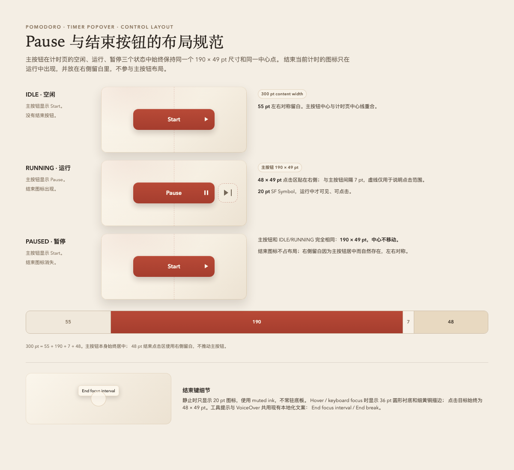

# Pause 与结束按钮布局规范

**设计交接与实现规格**

| Field | Value |
| --- | --- |
| Status | Layout and next-interval behavior implemented locally and verified. Not committed or released. |
| Date | 2026-11-24 |
| Platform | macOS 15+ |
| Scope | 计时页底部控制区 |
| Parent design | [`2026-11-21-pomodoro-product-design.md`](2026-11-21-pomodoro-product-design.md) |
| Related | [`2026-11-24-mode-color-system.md`](2026-11-24-mode-color-system.md), [`2026-11-23-direct-break-design.md`](2026-11-23-direct-break-design.md) |
| Supersedes | 计时页现有的 `stop.fill` 方形结束键，以及相关规格中“停止键不在本次范围内”的描述 |

> **Revision 2026-11-24:** Focus 与 Break 的结束键都直接结束当前计时，不显示内联确认行、确认弹窗或其他二次确认。结束当前计时后，界面立即进入 Pomodoro 循环的下一段；提前结束的 Focus 计入四轮节奏，但仍不是自然完成。结束提示音保留，下一段是否自动开始由对应的 Auto-start 设置决定。

## 1. 一页摘要

计时页的主按钮在空闲、运行、暂停三个状态中使用同一个固定尺寸：

- 宽度 `190 pt`
- 高度 `49 pt`
- 始终水平居中
- 中心点始终与计时页中心线重合

当前计时正在运行时，主按钮显示 `Pause`。此时右侧出现一个不参与主按钮布局的结束键：

- 点击区 `48 × 49 pt`
- 可视图标约 `20 × 20 pt`
- 使用 SF Symbol `forward.end.fill`
- 与主按钮间隔 `7 pt`
- 只在 `model.isRunning == true` 时显示

结束键以覆盖层形式放在控制行右侧，不加入主按钮所在的 `HStack`。因此它出现或消失时，主按钮的位置、宽度和中心点都不会变化。

暂停时主按钮显示 `Start`，结束键完全消失，且没有单向空槽。左侧和右侧的 `55 pt` 留白对称。

Focus 与 Break 运行时点击结束键都直接结束，不显示确认行或弹窗。Focus 提前结束后进入下一段 Short 或 Long Break；Break 提前结束后进入下一段 Focus。下一段立即显示 Ready 或运行界面，是否自动开始由对应的 Auto-start 设置决定。



本图只描述控制区和它所在的 340 pt 卡片宽度，不代表当前计时盘样式。实现时保留仓库中当前的 `DialView`，不得重画或修改表盘。

## 2. 要解决的问题

当前运行态使用一个红色 `stop.fill` 方形按钮作为结束动作。该按钮位于主按钮右侧，并与主按钮一起由 `HStack` 布局。

本方案要解决三个问题：

1. 降低结束动作的视觉重量，使其不再像第二个主操作。
2. 只在用户看到 `Pause` 时提供结束当前计时的入口。
3. 避免图标出现或消失时导致主按钮宽度、位置或中心点跳变。

## 3. 目标与非目标

### 3.1 目标

- 计时页主按钮在所有状态中保持 `190 × 49 pt` 且居中。
- `Pause` 与 `Start` 使用完全相同的按钮框。
- 结束键只在运行时出现，并且有足够大的点击区域。
- 结束键不参与主按钮布局，显示或隐藏时不会造成 reflow。
- 保持现有模式配色、字体、圆角、阴影和按压反馈。
- 结束当前 Focus 或 Break 后，立即按四轮 Pomodoro 循环进入下一段，不进入确认流程。
- 提前结束的 Focus 计入四轮节奏；第四段 Focus 无论自然完成还是提前结束，都进入 Long Break。
- 保留上一段的结束提示音、通知清理和 Auto-start 规则。
- 在自动开始的下一段中保留 1 秒的视觉/听觉交接时间；首秒倒计时保持满格。

### 3.2 非目标

- 不修改表盘、标题、状态行、页脚、菜单栏图标或 Settings 布局。
- 不修改 Completion 页面、Settings 页面或更新相关 UI。
- 不新增全局快捷键。
- 不改变专注或休息的自然完成规则。
- 不把结束动作实现成无延迟地开始下一段倒计时。
- 不在本次实现中显示或保存用户可见的 Focus 编号或历史统计。
- 不把结束后的 Ready 阶段跨重启保留。
- 不为结束键增加可见文字标签。

## 4. 术语

| 术语 | 含义 |
| --- | --- |
| 主按钮 / Primary | 计时页底部的主要操作按钮，文案为 `Start` 或 `Pause` |
| 结束键 / End control | 运行中显示的 `forward.end.fill` 图标按钮，用于结束当前计时 |
| 控制行 / Control row | 包含主按钮的固定 `300 × 49 pt` 横向区域 |
| 运行中 | `model.isRunning == true`，主按钮显示 `Pause` |
| 暂停 | `model.isPaused == true`，主按钮显示 `Start` |

## 5. 状态与行为

### 5.1 状态矩阵

| 状态 | 主按钮 | 主按钮尺寸 | 结束键 | 结束键可点击 |
| --- | --- | --- | --- | --- |
| Idle | `Start` | `190 × 49 pt`，居中 | 不显示 | 否 |
| Focus running | `Pause` | `190 × 49 pt`，居中 | 显示 | 是 |
| Break running | `Pause` | `190 × 49 pt`，居中 | 显示 | 是 |
| Focus paused | `Start` | `190 × 49 pt`，居中 | 不显示 | 否 |
| Break paused | `Start` | `190 × 49 pt`，居中 | 不显示 | 否 |
| Completed | 由 Completion 页面负责 | Completion 页面保持现状 | 不显示 | 否 |

没有“结束确认”状态。运行中点击结束键后直接进入循环的下一段；该段可能是 Ready，也可能因 Auto-start 而立即进入运行态。

### 5.2 主按钮行为

| 状态 | 点击结果 |
| --- | --- |
| Idle | 启动当前选中的 Focus、Short break 或 Long break |
| Running | 暂停当前计时 |
| Paused | 恢复当前计时 |

主按钮行为复用现有 `TimerModel` 方法，不新增计时操作。

### 5.3 结束键行为

结束键只在计时运行时存在。

#### Focus running

点击结束键后：

1. 不显示内联确认行、弹窗或其他二次确认，立即结束当前 Focus。
2. 将本次 Focus 计入当前四轮节奏。它不是自然完成，不进入
   Completion 页面，但会影响下一段休息是 Short 还是 Long。
3. 按 Focus 在本组中的位置选择下一段：
   - 第 1、2、3 段 Focus → Short Break；
   - 第 4 段 Focus → Long Break。
4. 立即播放当前 Focus 的结束提示音，前提是 Completion chime 已开启。
5. 界面立即切换到下一段 Break：
   - Auto-start Break 开启：显示运行的 Break，倒计时先保持满格 1 秒，
     然后开始；
   - Auto-start Break 关闭：显示该 Break 的 Ready 页面，不开始计时。
6. 取消当前 Focus 已排队的结束通知。由于结束动作发生在前台，不额外发送
   系统完成通知；下一段若自动开始，只为下一段的预定结束时间安排通知。

#### Break running

点击结束键后：

1. 不显示确认行、弹窗或其他二次确认，立即结束当前 Short 或 Long Break。
2. 不改变 Focus 的四轮节奏计数。
3. 立即播放当前 Break 的结束提示音，前提是 Completion chime 已开启。
4. 界面立即切换到下一段 Focus：
   - Auto-start Focus 开启：显示运行的 Focus，倒计时先保持满格 1 秒，
     然后开始；
   - Auto-start Focus 关闭：显示 Focus 的 Ready 页面，不开始计时。
5. 取消当前 Break 已排队的结束通知。由于结束动作发生在前台，不额外发送
   系统完成通知；下一段若自动开始，只为下一段的预定结束时间安排通知。

#### 结束交接的固定延迟

提前结束进入自动开始的下一段时，使用固定 1 秒的交接延迟：

- 界面切换不等待该延迟，立即显示下一段。
- 下一段先显示满时长；1 秒后才开始减少。
- Completion chime 关闭时仍保留这 1 秒延迟。
- 初始实现值固定为 1 秒，并集中为一个可调常量。最终视觉验收可在
  1–2 秒范围内调整；调整不得改变状态机或通知语义。
- 菜单栏、进度环和按钮状态从界面切换起即显示下一段的运行态。

#### 与自然完成的区别

- 提前结束不会显示自然完成的 Completion 页面。
- 提前结束的 Focus 计入四轮节奏，但不算“自然完成”；未来显示
  “已完成 Focus”统计时不能把它当作自然完成数量。
- 自然完成在 Auto-start 关闭时的 Completion 页面、通知和提示音行为保持
  不变。

### 5.4 暂停状态

暂停时不显示结束键，这是本设计的明确行为：

- 暂停状态没有直接结束入口。
- 用户若想结束暂停中的计时，需要先点击 `Start` 恢复，再点击结束键。
- 不得为了保留结束入口而在暂停时保留透明或禁用图标。

该限制应由产品、设计和实现共同保留，除非以后另行修改本规格。

## 6. 布局规范

### 6.1 容器

计时卡片尺寸保持不变：

- 卡片宽度：`340 pt`
- 卡片高度：`510 pt`
- 水平内边距：左右各 `20 pt`
- 控制行内容宽度：`300 pt`
- 控制行高度：`49 pt`

不得通过修改卡片宽度、水平内边距或控制行高度来腾出空间。

### 6.2 控制区几何

从左到右：

```text
55 pt 留白 | 190 pt 主按钮 | 7 pt 间距 | 48 pt 结束键点击区
```

总和：

```text
55 + 190 + 7 + 48 = 300 pt
```

关键约束：

- 主按钮必须由控制行中心定位，宽度固定为 `190 pt`。
- 主按钮左右各有 `55 pt` 留白；这个留白是按钮居中后的自然结果。
- 结束键点击区的右边缘与控制行右边缘对齐。
- 结束键与主按钮之间的实际可点击区域间隔为 `7 pt`。
- 不得把结束键放进与主按钮共享伸缩空间的 `HStack`。
- 不得用一个只出现在右侧的占位视图维持主按钮宽度。
- 不得让主按钮自己参与“按钮 + 间距 + 结束键”的总宽度计算。

### 6.3 主按钮视觉

主按钮沿用现有 `PrimaryCTAButtonStyle` 和 `PrimaryButtonLabel` 的视觉规则，只改变外层宽度：

- 高度：`49 pt`
- 宽度：`190 pt`
- 圆角：`12 pt`
- 文案：`Start` 或 `Pause`
- 尾部图标：现有 `play.fill` / `pause.fill`
- 字体、字重、渐变、描边、阴影、按压缩放全部保持当前实现
- 按钮填充继续使用当前模式的 `ModeColors`

主按钮的可见文字和尾部图标均保持居中逻辑；不要为缩小宽度改动字号或图标大小。

### 6.4 结束键视觉

点击区域：

- 宽 `48 pt`
- 高 `49 pt`
- 与主按钮同高
- 右对齐到控制行

可见图标：

- SF Symbol：`forward.end.fill`
- 目标视觉尺寸约 `20 × 20 pt`
- 静止颜色：`Palette.mutedInk`
- Hover / keyboard focus 颜色：`Palette.ink`

静止状态：

- 无底板
- 无边框
- 不显示文字

Hover / keyboard focus：

- 显示 `36 × 36 pt` 圆形衬底
- 衬底填充：`Palette.plaque.opacity(0.72)`
- 衬底描边：`Palette.brass.opacity(0.34)`，`1 pt`

按压反馈：

- 可保留约 `0.94` 的轻微缩放
- 不得移动布局
- Reduce Motion 开启时取消缩放

工具提示：

- Hover 时通过 `.help(...)` 显示本地化文案
- Focus：复用 `timer.action.end_focus`
- Break：复用 `timer.action.end_break`

### 6.5 图标语义

图标表达的是“结束当前计时并继续 Pomodoro 循环”，不是自然完成：

- Focus 提前结束计入四轮节奏；Break 提前结束不改变 Focus 节奏。
- 下一段是否自动开始由对应的 Auto-start 设置决定。
- 结束提示音按 Completion chime 设置播放。
- 前台不额外显示系统完成通知；下一段自动开始时，安排下一段自己的结束通知。
- 不显示自然完成的 Completion 页面。
- 不使用 `skipInterval()` 或其他绕过节奏与通知规则的动作。

视觉上虽然使用 `forward.end.fill`，语义必须由辅助功能标签和 hover 文案补足。

## 7. 实现契约

### 7.1 涉及文件

预期改动：

- `Sources/PomodoroCore/TimerState.swift`
- `Tests/PomodoroCoreTests/`
- `Sources/Pomodoro/Model/TimerModel.swift`
- `Sources/Pomodoro/Views/PopoverViews.swift`
- 如有必要，在 `Sources/Pomodoro/Views/Components.swift` 调整结束键样式

不应修改：

- `Sources/Pomodoro/Views/DialView.swift`
- Settings、Completion 或 Sparkle 的视觉设计
- 版本号或依赖

### 7.2 推荐布局结构

当前实现不能继续使用以下结构：

```swift
// 禁止：条件插入会改变主按钮宽度和中心点
HStack(spacing: 9) {
    primaryButton
    if model.isRunning {
        endButton
    }
}
```

实现必须让主按钮独立居中，结束键作为覆盖层：

```swift
ZStack {
    primaryButton
        .frame(width: 190)

    if model.isRunning {
        endButton
            .frame(width: 48, height: 49)
            .frame(maxWidth: .infinity, alignment: .trailing)
    }
}
 .frame(maxWidth: .infinity)
 .frame(height: 49)
```

实现细节：

- `primaryButton` 在 `ZStack` 默认居中对齐。
- 结束键由右侧覆盖层定位，不参与 `primaryButton` 的测量。
- 结束键消失时不会保留透明占位。
- `if model.isRunning` 只增删覆盖层内容，主按钮不参与该条件分支的重排。
- `controls` 不包含结束确认状态或替换分支；任何状态只渲染固定主按钮，运行时额外渲染右侧覆盖层结束键。

### 7.3 常量建议

建议在 `TimerPopoverView` 内用私有常量表达尺寸，避免散落魔法数字：

```swift
private enum ControlMetrics {
    static let rowHeight: CGFloat = 49
    static let primaryWidth: CGFloat = 190
    static let endHitWidth: CGFloat = 48
    static let endIconSize: CGFloat = 20
    static let hoverDiscSize: CGFloat = 36
}
```

颜色必须继续从 `Palette` 和 `ModeColors` 读取，不得新增硬编码主题色。

### 7.4 结束键实现约束

- 使用真实的 `Button`，不要用 `onTapGesture` 代替无障碍控件。
- 使用 `.contentShape(Rectangle())` 或等效方式保证整个 `48 × 49 pt` 都可点击。
- 只用 `.opacity(0)` 隐藏是不够的；不在运行时必须完全不生成该按钮，或同时禁用命中与辅助功能。
- 显示状态必须绑定到 `model.isRunning`，不能绑定到 `!model.isIdle`。
- 不要直接复用现有 `SquareButtonStyle`；它带有常驻 plaque 底板和红色前景，不符合本设计。需要新增结束键样式或为该控件增加专用配置。
- Focus 与 Break 点击后都通过 `TimerModel` 直接执行结束并进入下一段。
- 不得进入内联确认行或新增确认弹窗，也不得引入结束确认状态。
- 继续复用现有 accessibility label / hint 本地化键；Focus hint 表达立即结束，不再表达确认。
- 不得只把计时状态重置为 Focus Idle；必须按当前阶段和四轮节奏推进。
- 不得把提前结束的 Focus 当作自然完成来显示 Completion 页面。
- 自动开始时使用统一的 1 秒交接延迟；不得依赖 Completion chime 开关决定
  是否延迟。

### 7.5 禁止事项

以下做法会让需求失效：

1. 把主按钮保留为 `maxWidth: .infinity`，再用条件 `HStack` 插入结束键。
2. 在暂停或空闲时保留一个只占右侧的透明槽位。
3. 把结束键叠在主按钮上，使两者点击区域重叠。
4. 使用 `stop.fill`、红色警告色或常驻底板。
5. 将 `190 pt` 自动扩展为填满可用空间。
6. 修改 `PrimaryCTAButtonStyle` 的全局最大宽度，从而影响 Completion 页面。
7. 在暂停状态下保留一个不可点击或隐藏的结束键占位。
8. Focus 结束后一律回到 Focus Ready，或 Break 结束后回到原 Break Ready。
9. 让自动开始绕过 1 秒交接延迟。

## 8. 字体、语言与主题

### 8.1 字体

- 主按钮继续使用 `Typo.sans(13.5, weight: "DemiBold")`
- 图标尺寸固定
- 不随语言切换改变按钮宽度或字号

### 8.2 支持语言

必须检查：

- English
- Simplified Chinese
- Traditional Chinese
- Japanese

主按钮只显示 `Start` / `Pause` 的本地化短文案，`190 pt` 宽度必须容纳全部四种语言。

切换语言时：

- 主按钮宽度、位置和中心点不变
- 结束键位置、图标尺寸和点击区不变
- Hover tooltip 和 VoiceOver 文案立即更新

### 8.3 主题

必须检查 Light 和 Black：

- 主按钮使用当前模式填充
- 结束键在两种主题下都使用对应的 `Palette.mutedInk`
- Hover 圆形衬底和描边使用相应主题 token
- 不新增颜色 token

## 9. 辅助功能

### 9.1 命中范围

- 结束键实际点击区：`48 × 49 pt`
- 大于 macOS 常用的 `44 × 44 pt` 最小目标
- Hover 圆形衬底只是视觉反馈，不应缩小点击范围

### 9.2 VoiceOver

运行中必须暴露一个独立的“结束”按钮：

- Focus 标签：`timer.action.end_focus`
- Focus 提示：`timer.action.end_focus_hint`
- Break 标签：`timer.action.end_break`
- Break 提示：`timer.action.end_break_hint`

空闲或暂停时：

- 结束按钮不出现在 VoiceOver 顺序中
- 不播报不存在的控件

### 9.3 键盘

- 运行时，Tab 顺序为：主按钮 → 结束键 → 页脚可聚焦元素
- 结束键必须有可见的键盘焦点指示
- Enter 或 Space 必须触发与点击相同的动作
- 暂停时结束键不参与 Tab 顺序

### 9.4 Hover 文案

- Focus：`End focus interval`
- Break：`End break`
- 复用现有本地化字符串
- 不新增仅英文硬编码文案

## 10. 动效

- 结束键出现/消失不改变任何几何布局。
- 不需要空间位移动画。
- 可以省略动画；如需淡入淡出，只能影响透明度，持续时间不超过 `160 ms`。
- 不得对主按钮宽度、结束键位置或控制行高度做动画。
- Reduce Motion 开启时取消所有非必要动效。

## 11. 边界与异常

### 11.1 计时在点击前自然完成

若用户点击结束键时计时已经自然完成，按现有 engine 状态处理；不得再次结束、重复计数或播放两次完成反馈。

### 11.2 直接结束后的状态

点击结束键后立即结束，不存在确认中间态：

- 当前阶段的结束键不再代表已结束的阶段。下一段若自动开始，结束键继续按
  普通运行态显示；下一段若停在 Ready，结束键消失。
- Focus 进入下一段 Break；Break 进入下一段 Focus。
- 下一段根据对应 Auto-start 设置显示 Ready 或运行状态。
- 不把结束确认或键盘焦点状态带入下一段页面。

### 11.3 自动开始

点击结束键时读取当时的 Auto-start Break / Auto-start Focus 设置：

- 主按钮显示 `Pause`
- 结束键按普通运行态出现
- 自动开始状态没有新的布局分支
- 界面立即显示下一段，倒计时保持满格 1 秒后才开始
- 在 1 秒交接期间修改 Auto-start 设置，不取消已经开始的下一段

### 11.4 通知

- 点击结束键时取消当前计时原定结束时间的待处理通知，避免稍后出现过期提醒。
- 结束动作发生在应用前台，因此不额外发送一条系统完成通知；界面和提示音
  负责前台反馈。
- 下一段若自动开始，按下一段延迟后的结束时间安排通知。
- 下一段若停在 Ready，不保留任何待处理通知。
- 自然完成的后台通知行为保持不变。

### 11.5 Ready 状态的持久化

- 不新增“下一段 Ready 阶段”的持久化。
- 在结束后的 Ready 页面退出并重新启动应用时，空闲界面回到 Focus Ready。
- 运行中或暂停中的计时继续按现有恢复规则处理。
- 判定 Short/Long Break 所需的节奏计数仍按现有状态持久化；它不是新的
  用户可见统计。

### 11.6 修改语言

运行中修改语言时：

- 不重启计时
- 不改变控制区几何
- tooltip、VoiceOver 标签和主按钮文案立即刷新

### 11.7 Reduce Transparency

减少透明度开启时：

- 结束键不依赖透明衬底表达可点击性
- Muted ink 图标仍必须清晰可见
- Hover 圆形衬底可以退化为不透明或低透明度状态，但尺寸不变

## 12. 验收标准

### 12.1 自动化与构建

- [ ] `swift test` 通过。
- [ ] `./scripts/build-app.sh debug` 通过，包括本地化资源检查、签名和 entitlement 校验。
- [ ] 不新增依赖，不修改 `Package.resolved`。
- [ ] 不修改版本号。

### 12.2 交互

- [ ] 空闲时主按钮为 `190 × 49 pt`，居中，显示 `Start`。
- [ ] 开始时主按钮变为 `Pause`，宽度、高度和中心点不变。
- [ ] 运行时结束键出现，点击区为 `48 × 49 pt`。
- [ ] 结束键与主按钮不重叠。
- [ ] 暂停时结束键消失，主按钮仍为 `190 × 49 pt` 且居中。
- [ ] 暂停/恢复反复操作时，主按钮不横向跳动、不改变宽度。
- [ ] Focus 1–3 运行中点击结束键，立即进入下一段 Short Break，不显示确认行或弹窗。
- [ ] 连续结束的前四段 Focus 中，第 4 段结束后立即进入 Long Break。
- [ ] Short Break 或 Long Break 运行中点击结束键，立即进入下一段 Focus。
- [ ] Auto-start Break 关闭时，结束 Focus 后停在对应 Break 的 Ready 页面。
- [ ] Auto-start Break 开启时，结束 Focus 后显示运行的 Break；倒计时保持
      满格 1 秒后开始。
- [ ] Auto-start Focus 关闭时，结束 Break 后停在 Focus 的 Ready 页面。
- [ ] Auto-start Focus 开启时，结束 Break 后显示运行的 Focus；倒计时保持
      满格 1 秒后开始。
- [ ] Completion chime 开启时，结束 Focus 或 Break 会立即播放对应阶段的结束提示音。
- [ ] Completion chime 关闭时仍保留 1 秒交接延迟。
- [ ] 提前结束不会显示自然完成 Completion 页面。
- [ ] 提前结束的 Focus 推进四轮节奏，但不计入未来的“自然完成”统计口径。
- [ ] 前台结束时旧的待处理通知被取消，不弹出过期的系统通知；下一段自动
      开始时会安排自己的结束通知。
- [ ] 停在结束后的 Ready 页面时退出并重启，空闲界面回到 Focus Ready。
- [ ] 暂停状态没有直接结束入口，符合第 5.4 节。

### 12.3 布局与视觉

- [ ] 控制行宽 `300 pt`。
- [ ] 主按钮左右各 `55 pt` 留白。
- [ ] 主按钮与结束键点击区间隔 `7 pt`。
- [ ] 结束键图标约 `20 × 20 pt`。
- [ ] 结束键静止时无底板，Hover / focus 时显示 `36 pt` 圆形衬底。
- [ ] 主按钮在四种语言中都不截断。
- [ ] Light 和 Black 主题下图标、衬底和 Hover 状态清晰。
- [ ] Reduce Transparency 和 Reduce Motion 下没有布局变化。
- [ ] Completion 页面主按钮仍保持现有全宽样式。
- [ ] Settings 页面没有回归，卡片无需滚动。

### 12.4 辅助功能

- [ ] VoiceOver 在运行时能读出 Focus / Break 的结束标签和提示。
- [ ] VoiceOver 在空闲、暂停、完成状态中不暴露结束按钮。
- [ ] 键盘可以聚焦结束键，并显示焦点指示。
- [ ] Hover tooltip 与 VoiceOver 标签使用同一套本地化文案。
- [ ] 点击区实际覆盖整个 `48 × 49 pt`。

### 12.5 视觉检查方法

1. 运行 `./scripts/build-app.sh debug`。
2. 退出已有 Pomodoro 进程，再启动构建产物。
3. 分别在 Light、Black、Reduce Transparency、Reduce Motion 下检查。
4. 在 Idle、Focus running、Break running、Focus paused、Break paused 和
   Completion 中截图对照。
5. 逐一检查 Focus 1–4 的结束结果、Short/Long Break 的结束结果，以及两个
   Auto-start 开关的四种组合。
6. 对运行/暂停来回切换至少 3 次，确认主按钮中心线不变。
7. 用四种语言逐一检查按钮文案、Hover tooltip 和 VoiceOver。

## 13. 需要同步维护的文档

实现必须同时：

- 在 `TESTING.md` 增加对应回归项，覆盖固定宽度、居中、结束键位置、暂停态无结束入口、点击区、辅助功能、四轮节奏、1 秒交接、提示音与通知。
- 在相关旧规格中补充本规格的引用，避免后续 AI 继续把红色 `stop.fill` 当作当前设计。
- 在旧规格中删除“提前结束回到原模式 Idle、不推进节奏、不自动开始”的冲突描述。
- 不重新生成 README 截图；等发布准备阶段再更新。

## 14. 已确认的决定

以下决定已经由产品方确认，不需要实现者再次选择：

1. 主按钮固定为 `190 × 49 pt`，始终居中。
2. 结束键只在运行时显示，暂停时没有直接结束入口。
3. 结束键点击区为 `48 × 49 pt`，放在右侧留白中。
4. 结束键不参与主按钮布局。
5. 使用 `forward.end.fill`，不使用 `stop.fill`。
6. 不保留只占右侧的透明槽位。
7. Focus 与 Break 都直接结束，不显示确认行或弹窗。
8. Focus 结束后进入下一段 Break；Break 结束后进入下一段 Focus。
9. 提前结束的 Focus 计入四轮节奏，但不是自然完成。
10. 下一段是否自动开始由对应的 Auto-start 设置决定。
11. 自动开始时先显示运行界面，保持满格 1 秒后再启动倒计时。
12. 结束提示音保留；前台不额外发送系统完成通知。
13. Ready 页面不跨重启保留；数字编号另立需求。
14. 自然完成的 Completion 页面和 Settings 页面不变。

## 15. 交付定义

本需求完成时应满足：

- 计时页三个状态的按钮几何稳定。
- 运行中结束键只作为右侧覆盖层出现。
- 结束键按四轮循环进入下一段，节奏、提示音、通知和持久化符合本规格。
- `swift test` 与 `./scripts/build-app.sh debug` 通过。
- 已完成 `TESTING.md`、所需主题/语言/辅助功能检查。
